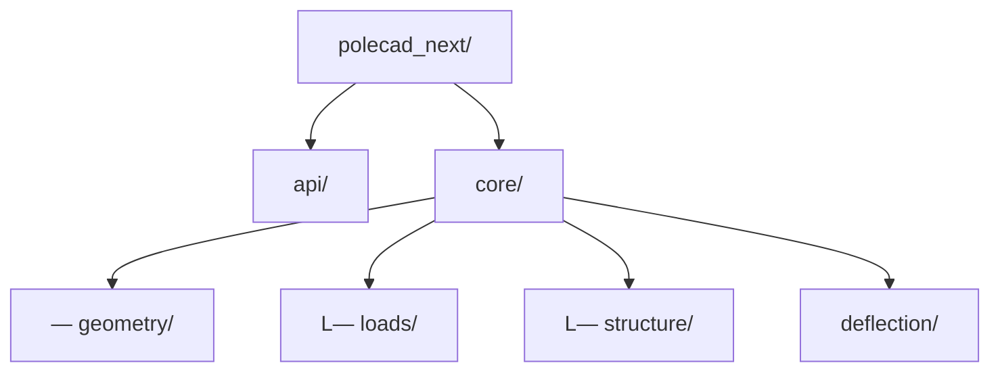

# Python_Power_Systems_Review_20261025_0001

<!-- page 1 (OCR + box regions) -->

Given your background, I would not approach this as a simple "refactor the code" effort.

I would approach it as building a utility engineering calculation platform that happens to start with pole loading.

Your original application solved a specific problem:

```plaintext
Input GIS poles
Input attachments
Calculate loading
Recommend guying
Generate reports
```

Today I'd design it so that in 10 years you can add:

- Joint use attachment analysis
- Pole replacement recommendations
- Windmil Integration
- GIS integration
- Structural upgrades
- LiDAR extraction
- Al-assisted engineering review
- Automated NESC validation

without rewriting the core again.

---

## Recommended Architecture

### Layer 1 - Data Model 

Everything should ultimately become typed objects.

Instead of:

```python
self.poledb["PoleHeight"]
self.poledb["PoleClass"]
```

use:

```python
Pole
Span
Conductor
Attachment
Guy
Anchor
LoadCase
```

<!-- page 2 (OCR + box regions) -->

Example:

```python
class Pole(BaseModel):
    pole_id: str
    species: str
    pole_class: str
    length_ft: float
    embedment_ft: float
```

Pydantic would be my recommendation.

Benefits:

- Validation
- Serialization
- FastAPI compatibility
- JSON export

___

## Layer 2 - Standards Library

This is probably the most important improvement.

Today your code contains things like:

```python
0.000264
8000
1.75
1.3
0.85
```

Future you won't remember where they came from.

Create:

```python
standards/
```

Structure:


<!-- page 3 (OCR + box regions) -->

Each factor should have metadata:

```json
{
    "id": "strength_factor_grade_c",
    "value": 0.85,
    "source": "NESC",
    "rule": "250C",
    "description": "Grade C construction strength factor"
}
```

## Layer 3 - Geometry Engine

Current code mixes geometry with loading.

Separate.

Module:

```python
geometry/
```

Functions:

```python
get_span_length()
get_azimuth()
get_angle_difference()
get_vector_components()
```

<!-- page 4 (OCR + box regions) -->

All GIS coordinate calculations belong here.

---

## Layer 4 - Load Engine

Module:

```python
loads/
```

Submodules:


Each returns forces.

Never moments.

Example:

```python
WindLoadResult
```

contains:
```python
Fx
Fy
Fz
attachment_height
```

## Layer 5 - Structural Engine

Convert forces into moments.

```python
structure/
```

Functions:

```python
calculate_groundline_moment()
calculate_resultant_moment()
calculate_capacity()
calculate_utilization()
```
This becomes the heart of the application.

---

## Layer 6 - Deflection Engine

Your current:

```python
deflectionFactor = 1.2
```

becomes:

```python
deflection/ Actual implementation:
```

For a cantilever:

or

depending on load type.

Store:

```json
{
    "species": "Southern Pine",
    "modulus_elasticity": 1800000
}
```

Now you can compute:

- pole-top displacement
- conductor clearance changes
- communication clearance violations

---

## Layer 7 - Pole Capacity

I would completely redesign this section.

Current:

<!-- page 6 (OCR + box regions) -->

```python
Mrn = 0.000264 * 8000 * C**3
```

Instead:

```python
diameter = circumference / pi

section_modulus = (pi * diameter**3) / 32

capacity = allowable_bending_stress * section_modulus
```

Benefits:

- Auditable
- Textbook mechanics
- Easy verification

Every engineer understands it immediately.

---

## Layer 8 - Calculation Cases

Today much appears blended together.

Modern approach:

```python
LoadingCase
```

Examples:

```python
Everyday
HeavyIce
HeavyWind
BrokenWire
Construction
ExtremeWind
```

Each contains:

```python
loads
factors
limits
```

<!-- page 7 (OCR + box regions) -->

Then:

```python
calculate_case()
```

returns:

```python
utilization
```

### Data Storage

For engineering reference data:

JSON.

Examples:

```json
{
  "pole_species": "json",
  "conductors": "json",
  "communications": "json",
  "guy_wire": "json",
  "anchors": "json"
}
```

For projects:

SQLite.

```python
project.db
```

Not pandas.

Pandas should only exist in:

```python
analytics/
```

or

```python
1 reporting/
```

Reporting

Separate entirely.

Current program intertwines engineering and reporting.

Create:

<!-- page 8 (OCR + box regions) -->

```python
reporting/
```

Outputs:

```python
Excel
PDF
HTML
JSON
GeoJSON
```

Same calculation result object fed to multiple output formats.

GIS Integration

This is where I think your next-generation version can significantly outperform commercial utilities.

Structure:

```python
gis/
```

Support:

```python
GeoJSON
Shapefile
ArcGIS REST
PostGIS
```

Objects:

```python
PoleLocation
SpanGeometry
CircuitGeometry
```

Since you already calculate actual conductor geometry, you'll gain more accuracy than many simplified pole loading tools.

Al Integration

For what you've been discussing recently, this is where I'd deliberately leave hooks.

Create:

<!-- page 9 (OCR + box regions) -->

```python
ai/
```

Future agents:

Pole Review Agent Input:

```python
PoleResult
```

Output: 7

Pole overloaded due primarily to: oa = - Secondary triplex - Fiber attachment - Span angle 38° Recommended: - 10M anchor - Replace with Class 3 pole

WindMil Agent Reads:

- WindMil exports
- e
- Device models

and generates engineering recommendations.

Proposed Folder Layout



<!-- page 10 (OCR) -->

```python
standards/

models/
    pole.py
    span.py
    conductor.py
    attachment.py
    guy.py

data/
    ansi/
    nesc/
    rus/

reporting/

gis/

ai/

web/

tests/
```

If I Were Prioritizing the Rewrite

Phase 1 (Highest Value)

Replace DataFrames with typed models. Separate geometry from loading. Externalize all constants.

Phase 2

Proper load-case engine. Proper standards library. Unit testing.

<!-- page 11 (OCR) -->

Phase 3

- Deflection calculations.
- Anchor capacity checks.
- Guy tension validation.

Phase 4

- FastAPI backend.
- Interactive web viewer.
- GIS integration.

Phase 5

- WindMil integration.
- Al engineering review.
- Automated recommendation engine.

The most important lesson from your original application is that the geometry-centric approach was actually ahead of many utility calculations of that era. I would preserve that concept. The biggest modernization opportunity is making every load, factor, equation, and standard traceable to a source document so that an engineer can click a result and immediately see which RUS, ANSI, or NESC equation produced it. That single design decision will make the next version much easier to trust, maintain, and eventually hand off to someone else.

