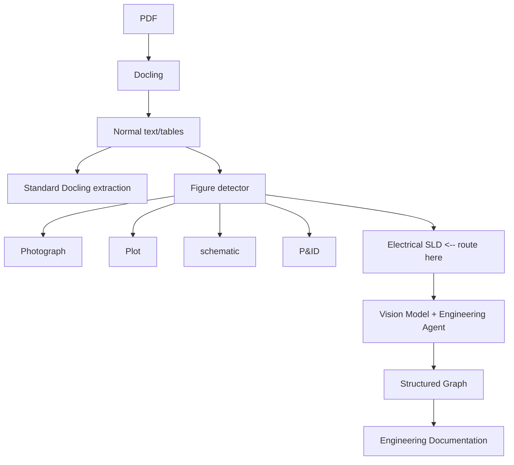
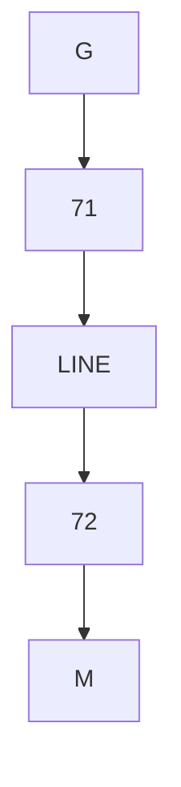
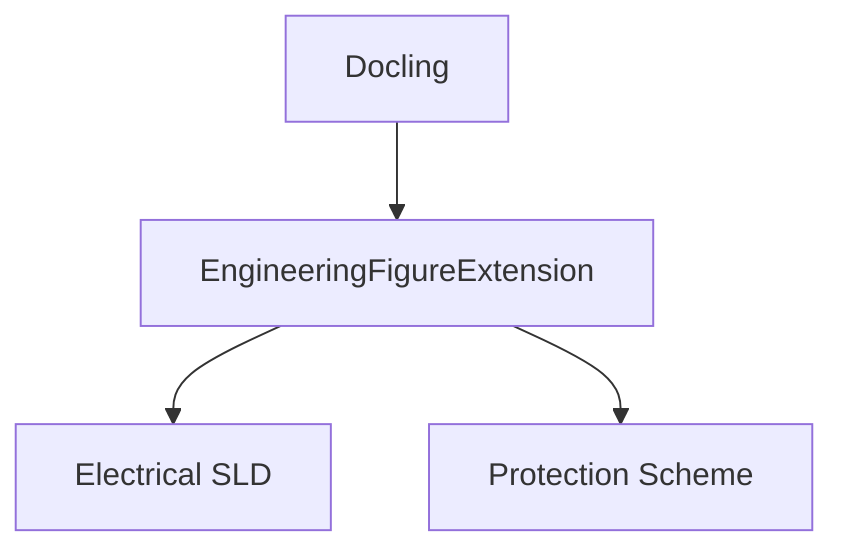
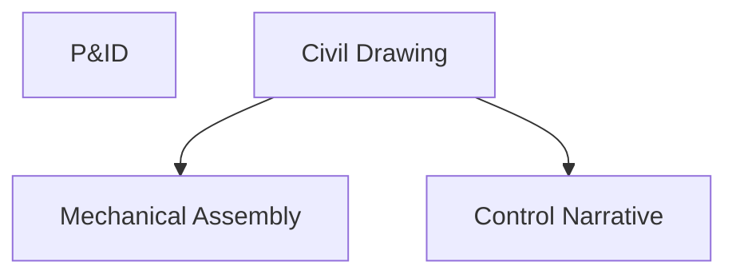

# electricalDiagramOCR

<!-- page 1 (OCR + box regions) -->

| think that's actually the architecture I'd recommend.

The weakness isn't Docling's OCR or document understanding. The weakness is that an electrical single-line diagram is fundamentally a graph with engineering semantics, not a document.

Proposed Pipeline



Stage 1: Detect “engineering drawings" The extension doesn't need to fully understand the diagram initially.

Just classify:

```json
{
"figure_type": "electrical_single line",
"confidence": 0.94
}
```

<!-- page 2 (OCR + box regions) -->

Features are surprisingly simple:

- electrical symbols
- transmission lines
- breakers
- transformers
- ANSI device numbers
- bus bars
- relay symbols

A lightweight CV classifier could do this.

Stage 2: Vision Model Extraction Once identified, send only the cropped diagram to a multimodal model.

Prompt example:

```
Analyze this electrical power-system
single-line diagram.
3
Identify:
5
- Components
- Connectivity
- Ratings
- Grounding methods
- Transformer vector groups
- Breakers
- Protective devices
13
Return JSON.
```

Expected result:

```json
{
"components": [
{
"id": "G",
"type": "generator",
"rating mva": 102,
"kv": 13.8
}5
```

<!-- page 3 (OCR + box regions) -->

```json
{
"id": "T1",
"type": "transformer", |
"connection": "delta-grounded_wye" |
fe }
],
15
"connections": [
re", "r1"4,
["T1i","LINE"],
["LINE","T2"],
["T2","M"]
]
+}
```

Stage 3: Python Engineering Plugin This is where the real value lives.

Convert extracted JSON into a network graph.

```python
import networkx as nx
```

Build:



Then automatically derive:

Positive Sequence Network

<!-- page 4 (OCR + box regions) -->

```
XT2
+
Xs(M)
```

Negative Sequence Network

```
X2(G)
+
XT1
+
XLINE
+
XT2
+
X2(M)
```

Zero Sequence Network Apply transformer rules:

```python
if transformer.primary == "delta":
block zero sequence()
```

Now you are producing engineering knowledge instead of OCR.

Stage 4: Specialized Engineering Agent The agent can then generate explanations like: | Transformer T1 is connected A-Yg. The delta winding prevents zero-sequence currents | from propagating between the generator and transmission network. Consequently, the _ generator zero-sequence network is isolated from the transmission line zero-sequence network.

That's exactly the sort of explanation that utilities, consultants, and protection engineers want.

An Even Better Approach i'd represent everything in a domain model rather than plain JSON.

```python
class Generator:
pass
3
```

<!-- page 5 (OCR + box regions) -->

```python
class Transformer:
pass
6
class TransmissionLine:
pass
:
class Bus:
pass
12
class Breaker:
pass
```

Then the vision output simply fills these objects.

Example:

```python
Transformer (
name="T1",
rating mva=100,
primary_kv=13.8,
secondary_kv=138,
vector_group="Dyg",
Z_pu=@.10
ae
```

Now downstream modules can:

- Generate sequence networks
- Produce relay settings documentation
- Create one-line reports
- Build CIM-compatible exports
- Calculate fault current paths
- Generate protection studies

without asking the LLM to reason from raw text every time.

What I'd Actually Build If | were extending Docling today, I'd add:



<!-- page 6 (OCR + box regions) -->



For electrical SLDs specifically:

- Detect diagram region
- Send crop to VLM
- Extract topology JSON
- Build NetworkX graph
- Run engineering-rule engine
- Generate documentation

The engineering-rule engine will provide more value than the vision model itself. The vision model identifies "A-Yg transformer"; the rule engine knows "zero-sequence current is blocked through the delta side." That's where the domain expertise really comes from.

